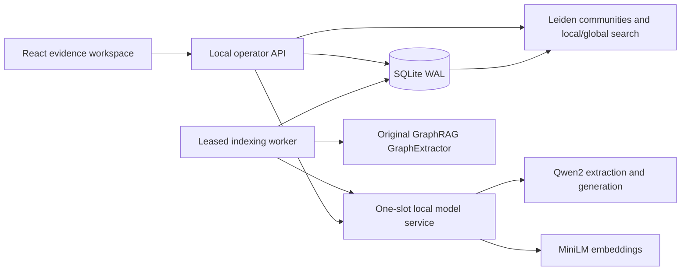

# Evidence and execution boundaries

## Source lifecycle

Documents have immutable revisions and exact codepoint-offset chunks. Updating or deleting a document advances the corpus generation and immediately excludes obsolete evidence. A job is identified by document revision and complete model/prompt profile. Repeated enqueue requests reuse that identity; they do not create extra work or reset consumed budgets.

Workers claim expiring leases and publish each chunk transactionally. Publication verifies the current lease, source revision and profile. A killed worker's completed chunk is reused after real lease expiry; an interrupted model reservation remains charged. Three attempts bound retries. Cancelled, superseded and failed jobs cannot expose partial evidence as a completed index.

## Extraction and correction

The model returns structured triples. The adapter requires literal source spans, rejects negative/uncertain clauses, removes duplicates and passes accepted records through the actual GraphRAG extractor. Exact spans are useful provenance, but they are not a general semantic entailment proof. Raw generations, accepted/rejected records and framework output remain available for inspection.

Leiden communities are rebuilt from the current accepted graph with a fixed seed. Corrections are append-only decisions with a reason and expected corpus generation. Rejecting a relationship excludes its entire passage from vector and graph retrieval. This conservative rule can reduce recall; restoring one claim does not restore a passage that still contains another rejected claim.

## Retrieval and model gates

All modes use the same MiniLM embeddings, evidence snapshot, six-passage limit and 2,400-character context limit. Vector mode ranks exact cosine similarity. Local mode promotes source-linked claims in an entity neighborhood. Global mode balances community evidence and uses the original framework's map/reduce search. The compact global adapter gives valid cited map results a binary score of one; this is inclusion, not model confidence.

Model calls reserve budget durably before inference. Query limits are eight calls and 24,000 reserved tokens; indexing exposes separately bounded call/token limits. Framework context accounting uses conservative byte counts; actual model input/output token counts are recorded separately. One API query or community report and one model inference run at a time. HTTP connection admission and read deadlines are bounded.

Answers must satisfy a strict JSON schema, name only supplied source IDs and use the explicit abstention contract. These checks establish reference validity, not factual correctness. If validation fails, the answer is withheld and retrieval diagnostics remain visible. If the corpus changes, completed runs become stale and their answer/model response bodies are hidden. Community reports are drafts and require the original framework schema.

## Supported scale

SQLite, exact vector scanning, in-memory graph construction and serial CPU inference target a bounded local collection. This is not distributed indexing, enterprise access control or a production performance claim. The operator API is local-only by deployment convention plus Host/Origin checks; those checks do not replace authentication. The model service is reachable only on the Compose network. External documents are rendered as text, never trusted HTML.
